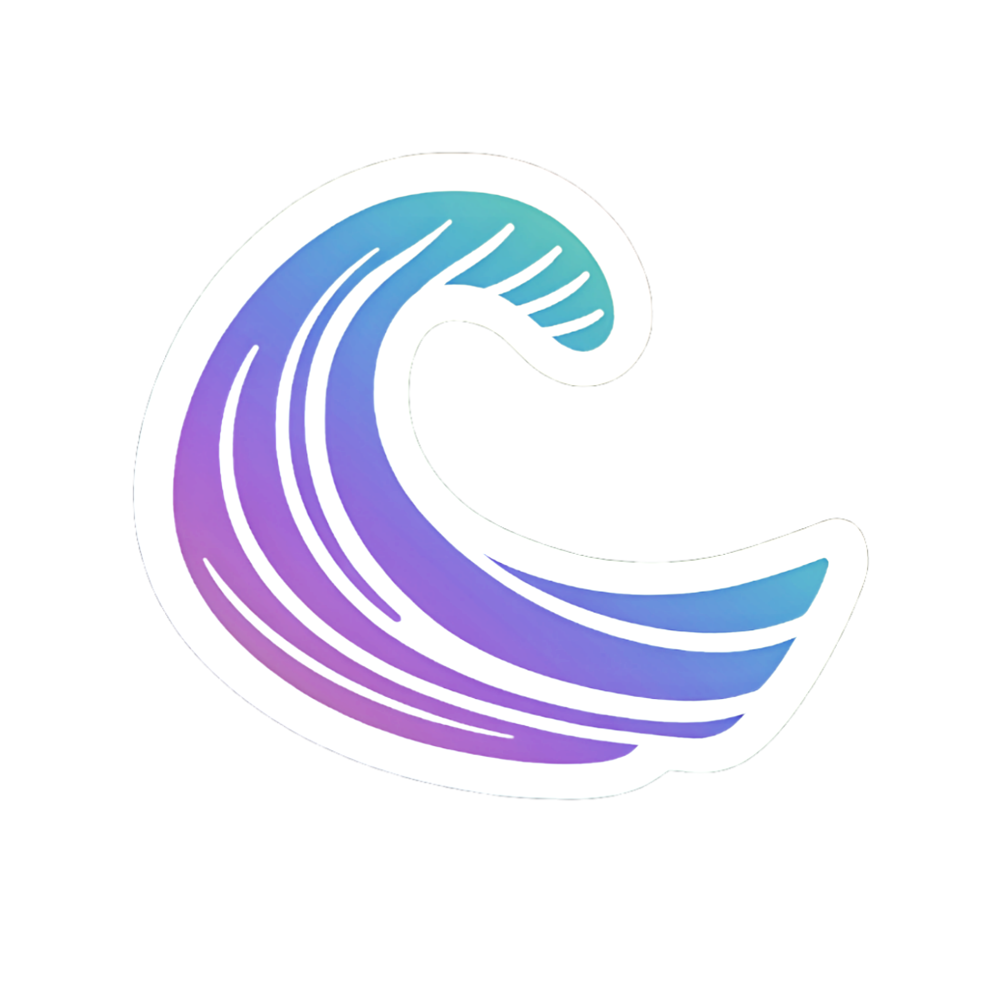

# Tidal

**Graphine Studios · Version 1.0 Beta**

Tidal is a client-side Fabric mod for Minecraft, providing a customizable
interface, HUD tools, and gameplay features.

- **Configured Minecraft targets:** 26.2, 26.3, and 1.21.11
- **Technical version:** `1.0.0-beta`
- **Studio and maintainer:** Graphine Studios
- **Related product ecosystem:** Aqua Client
- **Mod icon:** [logo.png](fabric/26.2/src/client/resources/assets/tidal/textures/gui/liquid-glass/tidal/brand/logo.png)

## License and Source Access

Tidal's source is publicly visible for inspection. Tidal is proprietary and
is not distributed under an open-source license. Public access does not grant
general permission to reuse, copy, modify, redistribute, or create derivative
projects from the source. Those uses require prior written authorization from
the relevant rights holders.

Graphine Studios does not claim ownership of every contribution. See
[CREDITS.md](./CREDITS.md) for attribution and [LICENSE](./LICENSE) for the
complete terms and contributor-rights qualifications.

## Build targets

The root Gradle project includes version-specific Fabric targets. The default
build target is `fabric/26.2`.

## Credits

See [CREDITS.md](./CREDITS.md) for contributor recognition.
